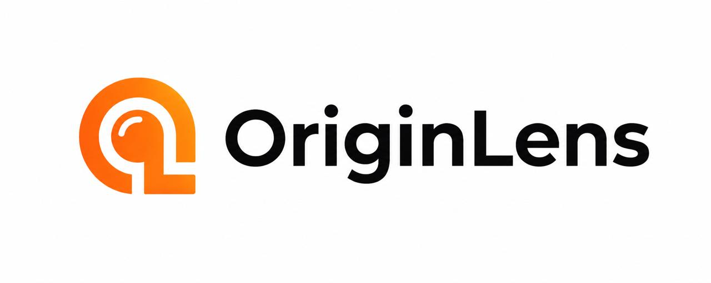

<<<<<<< HEAD
<div align="center">



### Understand where your content comes from.

A privacy-first SaaS for analyzing images and text: detect AI-generation signals,
inspect metadata and provenance, run reverse-image discovery, and rewrite text for
clarity, without permanently storing the files you upload.

<br />


[Features](#-features) ·
[Tech stack](#-tech-stack) ·
[Quickstart](#-quickstart) ·
[Configuration](#-configuration) ·
[Security](#-security) ·
[Roadmap](#-roadmap)

</div>

---

##  About

OriginLens helps people answer one question: **where did this content come from?**
Upload an image or paste text, and OriginLens gathers evidence (metadata,
technical traces, AI-generation signals and provenance clues) and presents it
as a clear, confidence-scored report.

> [!IMPORTANT]
> OriginLens never claims AI detection is 100% accurate. Results are always
> reported as **signals**, **evidence**, **confidence** and **conclusions**, never
> as absolute proof.

---

## ✨ Features

| | Feature | Description |
|---|---|---|
| 🖼️ | **Image analysis** | Upload or link an image to check AI-generation signals, EXIF data and technical traces |
| 🔍 | **Provenance & metadata** | Inspect embedded metadata, with optional sanitization |
| 🌐 | **Reverse-image discovery** | Find where an image appears elsewhere, where available |
| 📝 | **Text intelligence** | Heuristic and LLM-powered analysis of text, plus rewriting for clarity |
| 📊 | **Confidence scoring** | Every finding comes with a score and a confidence badge |
| 💳 | **Plans & quotas** | Free and Pro tiers with server-enforced limits and a currency toggle (USD / INR) |

---

## 🧭 Core principles

1. 🔒 **Privacy first.** Uploads are processed in temporary memory. Images and text are not stored permanently by default.
2. 💸 **Free and open-source resources wherever practical.** The only paid cost is LLM API usage.
3. 🧩 **Modular architecture.** Analyzers, providers and search backends can each be replaced independently.
4. 🛡️ **Secure by default.** Secrets live in env vars, with server-enforced quotas, SSRF protection, file-signature validation and secure headers.
5. 🔌 **Provider abstraction.** OpenRouter is the primary provider and Groq the fallback, and more are easy to add.
6. 🚦 **Rate limiting & graceful degradation.** Redis-backed, with provider failover and a friendly error envelope.
7. ♿ **Accessibility & responsive UI.** Keyboard-first and screen-reader friendly, from mobile to large desktop.
8. ⚖️ **Honest results.** No absolute claims about AI detection.

---

## 🛠️ Tech stack

| Layer | Technology |
|---|---|
| 🎨 Frontend | Angular 18 (standalone components, hand-rolled SCSS design tokens) |
| ⚙️ Backend | Python 3.10+ · FastAPI · Pydantic v2 |
| 🗄️ Database | PostgreSQL 16 · SQLAlchemy 2 (async) · Alembic |
| ⚡ Cache & rate limit | Redis 7 |
| 🔁 Background jobs | Celery + Redis |
| 🔐 Auth | Supabase |
| 🌍 Reverse proxy | nginx |
| 🐳 Orchestration | Docker Compose |
| ▲ Frontend hosting | Vercel |

---

## 📁 Repository layout

```
OriginLens/
├── backend/              FastAPI service (Python)
│   ├── app/
│   └── tests/
├── frontend/             Angular SPA (deployed on Vercel)
│   └── src/app/
│       ├── core/         services, guards, Supabase client
│       ├── features/     landing, analyzer, text, pricing, auth
│       ├── layout/       navbar, footer
│       └── shared/       reusable UI components & models
├── infra/
│   └── docker/           Dockerfiles, nginx config
├── docs/                 architecture.md, security.md
├── imag/                 logo & icon
├── docker-compose.yml    one-command dev stack
├── .env.example          copy to .env; never commit real values
└── pyproject.toml        workspace marker
```

See [`docs/architecture.md`](docs/architecture.md) for the full design.

---

## 🚀 Quickstart

### Prerequisites

- 🐳 Docker + Docker Compose
- 🐍 Python 3.10+ and 🟩 Node 20+ (optional, only to run services outside containers)

### One-command stack

```bash
# 1. Configure environment
cp .env.example .env
# Edit .env and add OPENROUTER_API_KEY (and/or GROQ_API_KEY)

# 2. Bring everything up
docker compose up --build
```

Once running:

| Service | URL |
|---|---|
| 🎨 Frontend | http://localhost:4200 |
| ⚙️ Backend | http://localhost:8000 |
| 📖 API docs | http://localhost:8000/docs |
| ❤️ Health check | http://localhost:8000/healthz |
| 🗄️ Postgres | localhost:5432 |
| ⚡ Redis | localhost:6379 |

<details>
<summary><b>⚙️ Run the backend outside Docker</b></summary>

```bash
cd backend
python -m venv .venv
source .venv/bin/activate   # Windows: .venv\Scripts\activate
pip install -e ".[dev]"
cp ../.env.example ../.env  # then edit
uvicorn app.main:app --reload
```

</details>

<details>
<summary><b>🎨 Run the frontend outside Docker</b></summary>

```bash
cd frontend
npm install
npm start
```

| Script | Purpose |
|---|---|
| `npm start` | Dev server on port 4200 |
| `npm run build` | Production build |
| `npm test` | Unit tests (headless Chrome) |
| `npm run lint` | Lint |
| `npm run typecheck` | TypeScript type check |

</details>

---

## 🔧 Configuration

All configuration comes from environment variables. See
[`.env.example`](.env.example) for the full, documented list.

> [!WARNING]
> **Never commit a real `.env` file.** `.env` is listed in `.gitignore`.

| Category | Variables |
|---|---|
| 📋 App & logging | `APP_ENV`, `APP_LOG_LEVEL`, … |
| 🗄️ Database & cache | `DATABASE_URL`, `REDIS_URL` |
| 🔐 Auth | `JWT_SECRET`, `JWT_ACCESS_TTL_SECONDS`, … |
| 🤖 LLM providers | `OPENROUTER_*`, `GROQ_*`, `LLM_PRIMARY`, `LLM_FALLBACK` |
| 🚦 Rate limits & quotas | `RATE_LIMIT_ENABLED`, `QUOTA_FREE_*`, `QUOTA_PRO_*` |
| 🖼️ Image limits | `MAX_UPLOAD_BYTES`, `MAX_IMAGE_PIXELS`, `ALLOW_SVG` |
| 💱 Pricing & FX | `PRICING_BASE_CURRENCY`, `FX_USD_TO_INR_FALLBACK` |
| 🛡️ Security | `CORS_ALLOWED_ORIGINS`, `SECURE_COOKIES`, `TRUSTED_HOSTS` |

---

## 🛡️ Security

OriginLens treats privacy as a first-class concern:

- 🚫 No images, text, API keys or passwords in logs
- 🚦 Server-enforced quotas and rate limits (Redis)
- 🌐 SSRF protection on URL analysis (private-IP blocking, redirect cap, size cap)
- 🧪 File validation by MIME type and magic bytes, not by extension
- 💣 Decompression-bomb protection (`MAX_IMAGE_PIXELS`)
- ✅ LLM responses validated with Pydantic before being trusted
- 🔒 CORS allowlisted to `FRONTEND_URL`, with secure headers in nginx and FastAPI

Read [`docs/security.md`](docs/security.md) for the full threat model.

> [!NOTE]
> Found a security issue? Please report it privately via GitHub Security
> Advisories (link to be configured).

---

## 🗺️ Roadmap

| Phase | Goal |
|:---:|---|
| 1 | Repository & architecture |
| 2 | Frontend shell with design tokens & routing |
| 3 | Image analyzer (upload, validation, EXIF, technical analysis) |
| 4 | Metadata sanitization |
| 5 | Text analyzer (heuristics) |
| 6 | LLM provider abstraction (OpenRouter, Groq, router) |
| 7 | Wire LLM into image & text analyzers |
| 8 | Auth (register, login, refresh, logout) |
| 9 | Subscriptions, server-enforced quotas & rate limits |
| 10 | Pricing page with currency toggle |
| 11 | Security hardening (SSRF, headers, decompression bombs, audit log) |
| 12 | Test suite: unit, integration, security |
| 13 | Production deployment (nginx, hardened Docker) |

Every phase ends with tests, type checks, lint, a `/healthz` check, a route smoke
test, a security review and a written summary.

---

## 📚 Documentation

- 🏗️ [`docs/architecture.md`](docs/architecture.md): system design, services, data model, provider abstraction, quotas and API surface
- 🛡️ [`docs/security.md`](docs/security.md): secrets, SSRF, file validation, rate limits, headers, logging and threat model

---

## 📄 License

License to be determined. All rights reserved until then.

<div align="center">
<br />

<br />
<sub>Built with care for privacy · © OriginLens</sub>
</div>
=======
# OriginLens

**Understand where your content comes from.** Privacy-first image metadata inspection, Content Credentials
(C2PA) verification, lossless metadata removal, an experimental AI-image pixel check, and explainable
text intelligence with AI rewriting.

| Part | Stack | Runs on |
|---|---|---|
| `frontend/` | Next.js 16 (App Router) + Tailwind v4 + Supabase JS, with server routes under `src/app/api` | Vercel |
| `supabase/` | Postgres migrations: profiles, welcome email (Resend via `pg_net`), usage limits | Supabase |

There is no separate API server. Image checks run in the visitor's browser; the few things that need a
server (AI writing, fetching an image by URL, usage limits) are Next.js route handlers on Vercel.

## Where each feature runs

| Feature | Runs in |
|---|---|
| Metadata (EXIF / XMP / IPTC / GPS), Content Credentials (official C2PA SDK in WebAssembly) | Browser |
| Privacy Clean (lossless removal of EXIF / XMP / IPTC / C2PA / comments for JPEG, PNG, WEBP) | Browser |
| AI labels in the file (C2PA source type, generator fields, diffusion parameters) | Browser |
| Pixel check (Community Forensics ViT-S/384, ONNX, 87 MB, downloaded on request) | Browser |
| Text Standard Scan (stylistic signals, no AI score) | Browser |
| Rewrite (5 tones + Humanize) and Deep Scan, via NVIDIA (Nemotron 3 Ultra) | `/api/text/rewrite`, `/api/text/deep-scan` |
| Analyze an image URL (SSRF-safe: public addresses only, ports 80/443, redirects re-checked) | `/api/images/analyze-url` |
| Free-use limits (logged out: 1 image + 1 text check per day; logged in: 10 AI calls per day) | `/api/usage/claim` + Supabase `consume_quota` |
| Sign-up (email code, Google, GitHub), profiles, welcome email | Supabase |

## Local development

Requirements: Node 20+.

```bash
cd frontend && npm install && npm run dev
```

The site reads `frontend/.env.local` (see `frontend/.env.example` and the root `.env.example`).

## Tests and checks

```bash
cd frontend && node --test src/lib/*.test.mts src/lib/server/*.test.mts && npx tsc --noEmit && npm run lint && npm run build
```

## Deployment

1. **Supabase**: apply `supabase/migrations` in order. Under Auth → URL configuration set the Site URL to
   your domain and add `https://<domain>/**` to Redirect URLs. Store the Resend key in Vault as
   `resend_api_key` (see `20261022181209_welcome_email.sql`).
2. **Vercel**: root directory `frontend`. Set `NEXT_PUBLIC_SUPABASE_URL`, `NEXT_PUBLIC_SUPABASE_ANON_KEY`,
   `SUPABASE_SECRET_KEY` (server only) and `NVIDIA_API_KEY` (server only).

## Privacy and security notes

- Images never leave the visitor's device, except when they ask us to fetch one by URL.
- Text sent to Rewrite or Deep Scan goes to NVIDIA's API to produce the result and is not stored by us.
- Usage limits are counted in a schema the public Supabase API does not expose; only the server's secret key can update them.
- Removing metadata never changes an image's true origin, and the UI says so.
>>>>>>> e1683f96e17add6e1bf1d5fa058ddf6f18bdaeef
